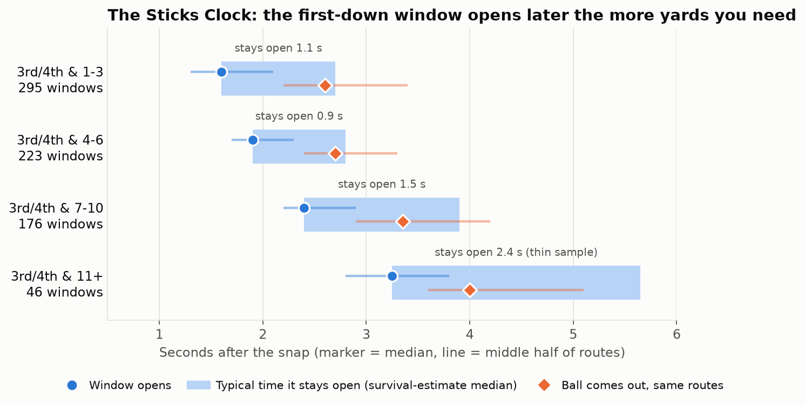
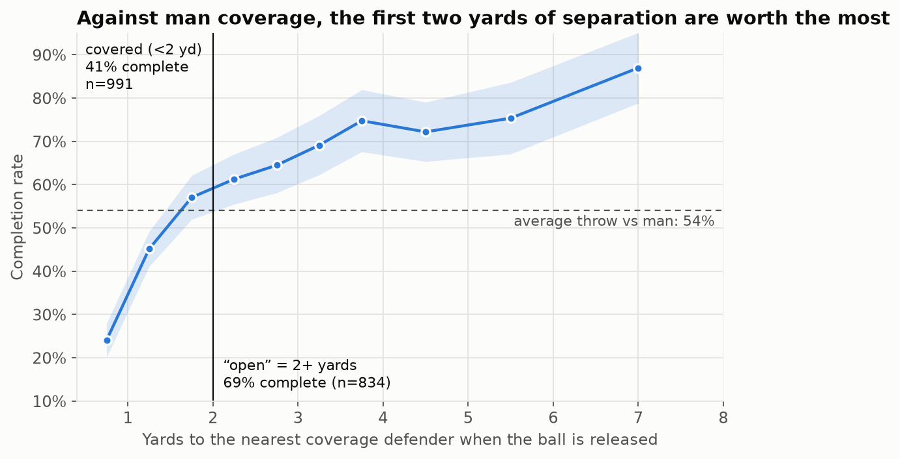
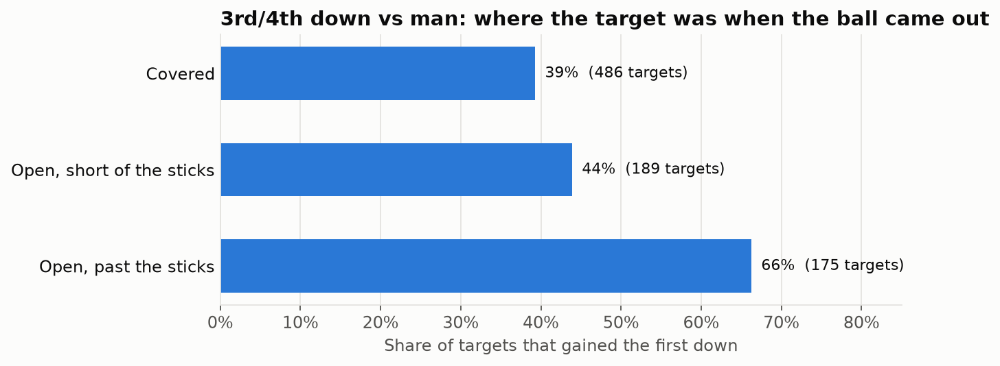
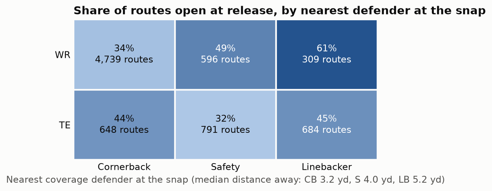
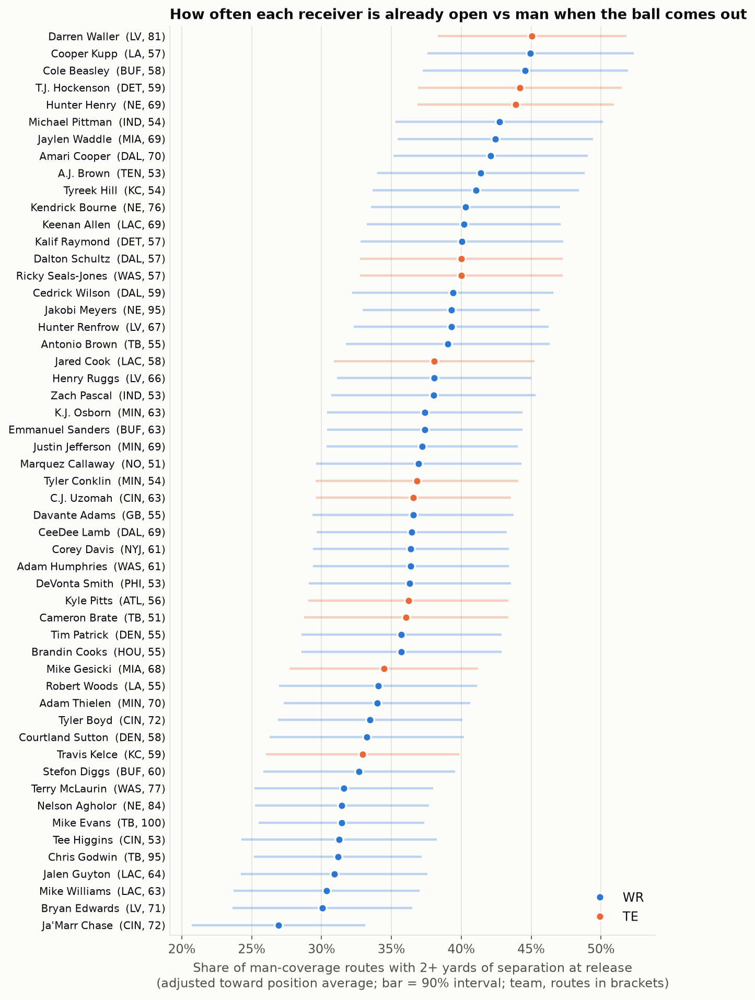

# The Sticks Clock

**On 3rd down against man coverage, when does a first-down throw come open, and how long does it stay open?**

On 3rd and 4th down against man coverage, the first-down window opens later the more yards the offense needs (a median 1.6 seconds after the snap with 1–3 to go, 1.9 with 4–6, 2.4 with 7–10 and about 3.3 with 11+), and 36% of windows (269 of 740) had closed before the ball came out. We timed every WR and TE route on those downs in Weeks 1–8 of 2021 (3,656 routes, 944 plays) from player tracking, where a window is at least 0.3 seconds with the receiver 2+ yards from the nearest coverage defender and at or past the first-down line; one opened on only 1 route in 5. Once open, a window typically stays open about 1.2 seconds (a survival estimate, because the throw cuts off windows that are still open), and targets still open at the throw gained the first down 66% of the time, against 49% for targets whose window had closed (only 53 targets) and 40% for targets who were never open. A coordinator or quarterback coach can use the clock for each distance to time route depth and the quarterback's drop to when the window is there, and the matchup grid and receiver profiles below to choose who to isolate. Tracking ends at the throw, so windows that would have opened later are invisible and opening times lean early; defenders are inferred from position rather than assignment, and the clock is a league-level finding, not a ranking of players.

## What a coach sees

**1. The Sticks Clock: the window opens later the more yards you need.**
On the routes where a window opened, the ball came out a median 2.9 seconds after the snap, about 0.8 seconds after the window opened at 2.1. Once open, a window typically stays open 1.2 seconds (Kaplan-Meier median; 1.1 on routes that were not targeted), and 78% last beyond 0.5 seconds. By distance, the window opened and the ball came out at 1.6 and 2.6 seconds with 1–3 to go, 1.9 and 2.7 with 4–6, 2.4 and 3.4 with 7–10, and 3.3 and 4.0 with 11+. The estimated time a window stays open is 1.1, 0.9, 1.5 and 2.4 seconds for the same four distances; the 11+ row has only 46 windows, so treat it as thin. Opening times lean early, because a window that would have opened after the throw is never seen.



**2. Two yards at release is the line between a bad throw and a good one.**
Across all downs against man, completion rate climbs steeply up to about 2 yards of separation and slowly after it: a target with 2+ yards is completed 69% of the time for 9.1 yards, a target without, 41% for 6.9. The curve crosses the average throw against man (54%) just before 2 yards, so we call 2+ yards "open": every half-yard band above it beats the average and every band below 1.5 falls short. The gap between open and covered is 28–31 points whether the line is drawn at 1.5, 2, 2.5 or 3 yards, so the finding does not depend on the exact cut.



**3. On the money down, open is not enough: it has to be open past the sticks.**
A WR or TE is open past the first-down line at the throw on 16% of 3rd/4th-down man routes (WRs 18%, TEs 12%). Throwing to one converts two times in three. Open but short of the sticks is barely better than covered. Of the 850 throws, 486 went to a covered receiver, and on 166 of those a teammate was open past the sticks.



**4. The matchup to hunt is a wide receiver whose nearest defender at the snap is a safety or linebacker.**
The defender is the coverage player nearest the receiver at the snap; "open" is still 2+ yards from the nearest defender at release. Wide receivers are open on 34% of routes when that defender is a cornerback, 49% for a safety and 61% for a linebacker, while tight ends get nothing from a safety (32%). Part of the linebacker number is alignment: on WR routes the nearest linebacker starts a median 5.8 yards away, against 3.0 for a cornerback.



**5. Receiver profiles: who is already open when the ball comes out.**
Receivers with 50+ man-coverage routes, all downs. The top of the chart is early separators (Waller, Kupp, Beasley, Hockenson). The bottom is mostly receivers who may win later (Chase, Mike Williams, Evans, Higgins), which this data cannot show. It is a description of style, not a ranking of quality: the rate has almost no relationship with yards per route.



## Run it

```
pip install -r requirements.txt
python make_report.py        # rebuilds every figure and number from outputs/routes_man.csv
python build_features.py     # optional: rebuilds routes_man.csv from the raw data in data/
```

The raw tracking data is not in this repo. `outputs/routes_man.csv` is the derived per-route table (one row per route against man coverage, including the window fields), so `make_report.py` runs without it. Every number quoted above is in `outputs/findings.json`, and the profile table is `outputs/receiver_profiles.csv`.

## Method

- **Release frame:** the first `pass_forward` or `autoevent_passforward` event; the snap is the first `ball_snap` or `autoevent_ballsnap`. Coordinates are flipped by `playDirection`.
- **Open:** 2+ yards from the nearest player PFF tagged as `Coverage`.
- **Past the sticks:** the receiver's depth beyond the ball's position at the snap is at least `yardsToGo`.
- **Window:** 3 or more consecutive frames (0.3 s), between snap and release, in which a WR or TE is both open and past the sticks. Opening time and duration come from the first window on the route; a window counts as closed if the receiver is no longer open past the sticks at the release frame. Typical duration is a Kaplan-Meier median in which a first window still open at the release frame is treated as censored.
- **Plays:** PFF coverage type `Man`, pass thrown (complete, incomplete or intercepted), target found in the play description.
- **Target:** parsed from `playDescription`, because there is no target column. It was found on 94.7% of thrown plays.
- **Profiles:** each receiver's open rate is pulled toward his position's average in proportion to how few routes he has (empirical Bayes), with a 90% interval.

## Assumptions and limitations

- Tracking stops at the throw. Windows that open after the throw are invisible, so opening times lean early.
- Durations use a survival estimate because the throw cuts off windows still open.
- The throw is not independent of the window, since quarterbacks tend to throw to open receivers, which is why the figure for non-targeted routes (1.1 seconds) is reported too.
- The "window closed before the throw" group is 53 targets, so its 49% first-down rate is a rough number.
- We make no claim about how long the quarterback should hold the ball. First-down rate is 55% on throws inside 2 seconds and 41–49% after, but longer holds also come with longer distances, and we have not separated the two.
- The clock is league-level. No receiver has more than 41 third- or fourth-down man routes, and the per-player open-past-the-sticks rate does not hold up between Weeks 1–4 and 5–8 (r = 0.17), so there is no player ranking.
- Receivers who separate while the ball is in the air, or win contested catches, look worse here than they may be.
- The nearest defender at the snap is not necessarily the assigned man. It is the same position group as the nearest defender at release on 80% of routes.
- Individual profile numbers are noisy. Comparing Weeks 1–4 with 5–8, the open rate correlates at 0.60 for the 24 receivers with 25+ routes in each half, but only 0.21 for the 45 with 20+.
- "A teammate was open" does not mean the quarterback could have thrown it: we do not model pressure, the read progression or throwing lanes.
- Sacks, scramble plays and throws with no tagged release are excluded. Rates are not adjusted for route depth or the quality of the defender.
